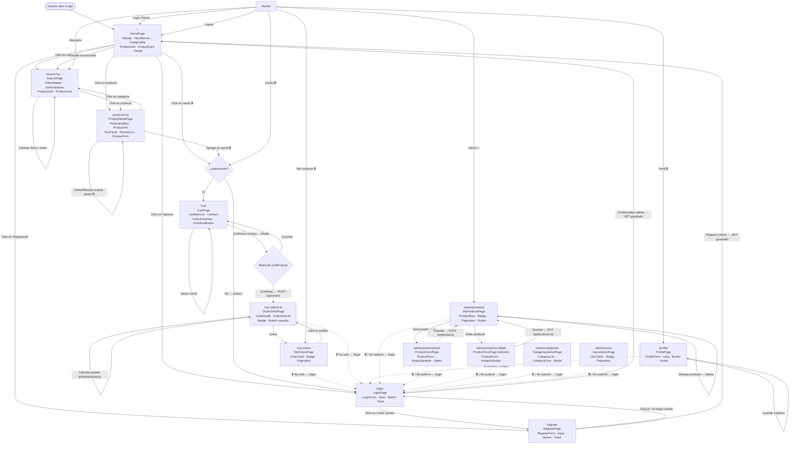

# 03 – Wireflow

> Diagrama de navegación completo. Las rutas marcadas con 🔒 redirigen a `/login` si el usuario no está autenticado. Las marcadas con 👑 requieren rol ADMIN.

## Mapa de Rutas

```
/                       → HomePage          (público)
/login                  → LoginPage         (público; redirect a / si ya logueado)
/register               → RegisterPage      (público; redirect a / si ya logueado)
/search                 → SearchPage        (público)
/products/:id           → ProductDetailPage (público)
/cart                   → CartPage          🔒
/my-orders              → MyOrdersPage      🔒
/my-orders/:id          → OrderDetailPage   🔒
/profile                → ProfilePage       🔒
/admin/products         → MyProductsPage    🔒 👑
/admin/products/new     → ProductFormPage   🔒 👑
/admin/products/:id/edit→ ProductFormPage   🔒 👑
/admin/categories       → CategoriesAdminPage 🔒 👑
/admin/users            → UsersAdminPage    🔒 👑
/design-system          → DesignSystemPage  (público, dev only)
```

---

## Diagrama Mermaid



---

## Por pantalla: componentes clave

| Pantalla | Ruta | Componentes |
|----------|------|-------------|
| HomePage | `/` | Navbar, HeroBanner, CategoryBar, ProductGrid, ProductCard, Footer |
| LoginPage | `/login` | LoginForm, Input, Button, Toast, Link |
| RegisterPage | `/register` | RegisterForm, Input, Button, Toast, Link |
| SearchPage | `/search` | Navbar, FilterSidebar, SortDropdown, ProductGrid, ProductCard, Pagination, Footer |
| ProductDetailPage | `/products/:id` | Navbar, ProductGallery, ProductInfo, BuyPanel, Rating, Badge, ReviewList, ReviewForm, ReviewItem, Spinner, Footer |
| CartPage | `/cart` | Navbar, CartItemList, CartItem, OrderSummary, CheckoutButton, Modal, Toast, Footer |
| MyOrdersPage | `/my-orders` | Navbar, OrderCard, Badge, Pagination, Skeleton, Footer |
| OrderDetailPage | `/my-orders/:id` | Navbar, OrderDetail, OrderItemList, Badge, Button, Toast, Footer |
| ProfilePage | `/profile` | Navbar, ProfileForm, Input, Button, Avatar, Toast, Footer |
| MyProductsPage | `/admin/products` | Navbar, ProductRow, Badge, Pagination, Modal, Button, Toast, Footer |
| ProductFormPage | `/admin/products/new` `/admin/products/:id/edit` | Navbar, ProductForm, Input, Select, Checkbox, ImageUploader, ProductImageList, Button, Toast, Spinner, Footer |
| CategoriesAdminPage | `/admin/categories` | Navbar, CategoryList, CategoryForm, Modal, Input, Button, Toast, Footer |
| UsersAdminPage | `/admin/users` | Navbar, UserTable, Badge, Pagination, Button, Modal, Footer |
| DesignSystemPage | `/design-system` | Todos los componentes base en exhibición |

---

## Rutas protegidas y comportamiento

| Tipo de ruta | Guard | Comportamiento |
|-------------|-------|----------------|
| `🔒` Autenticado | `ProtectedRoute` | Redirect a `/login` con `returnTo` en state |
| `👑` Admin | `AdminRoute` | Redirect a `/` con Toast "Sin permisos" |
| Login/Register ya logueado | `GuestRoute` | Redirect a `/` |
